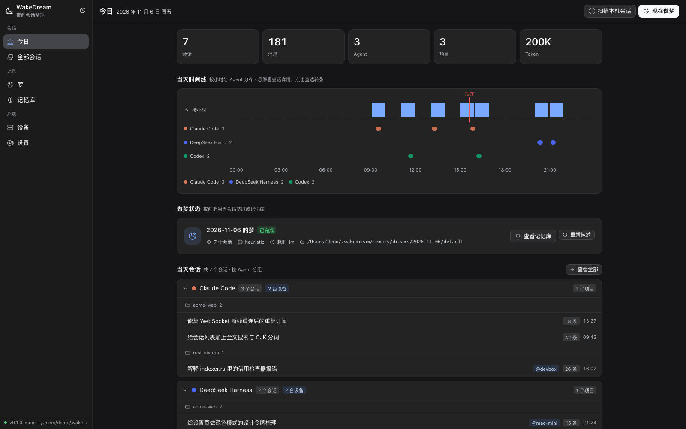
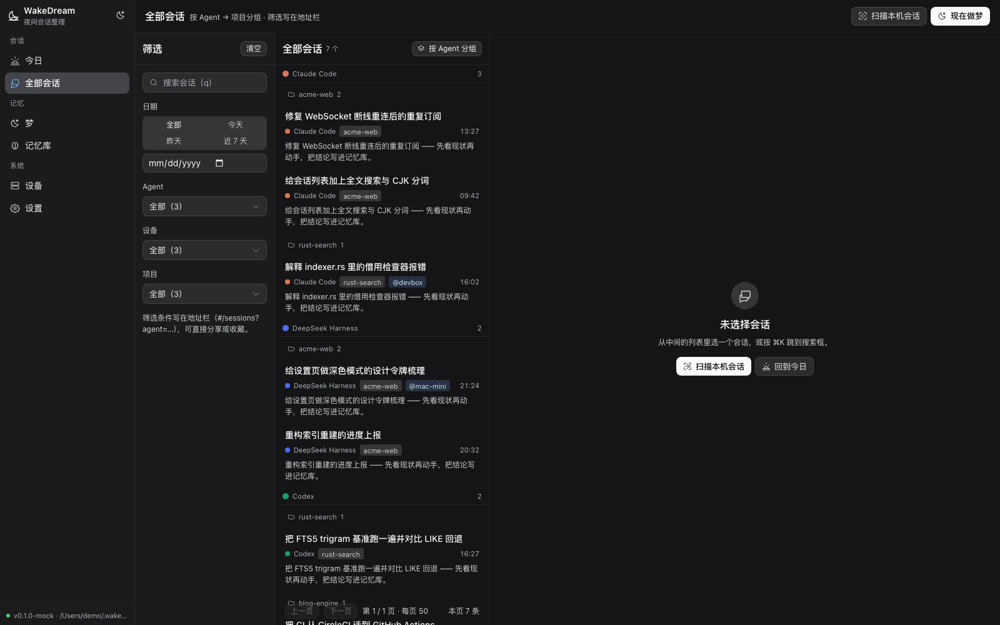
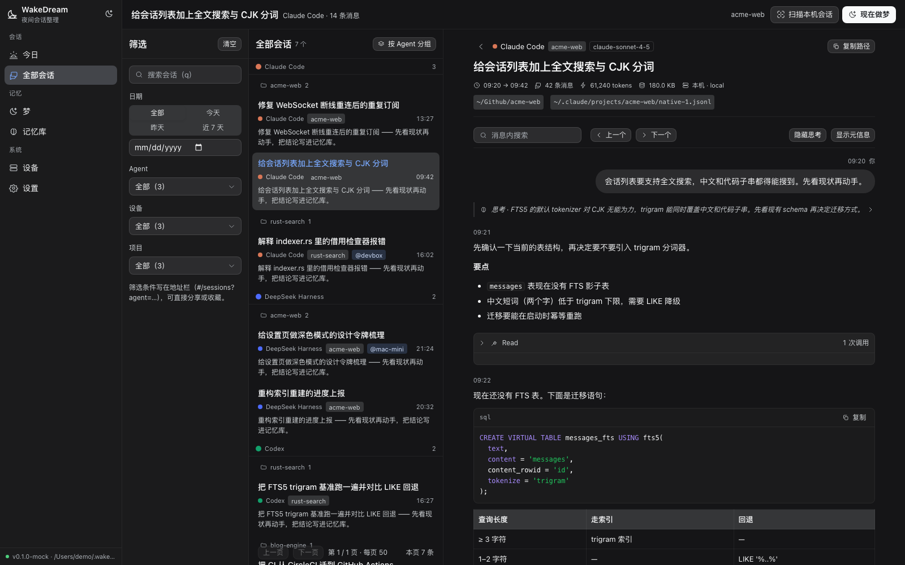
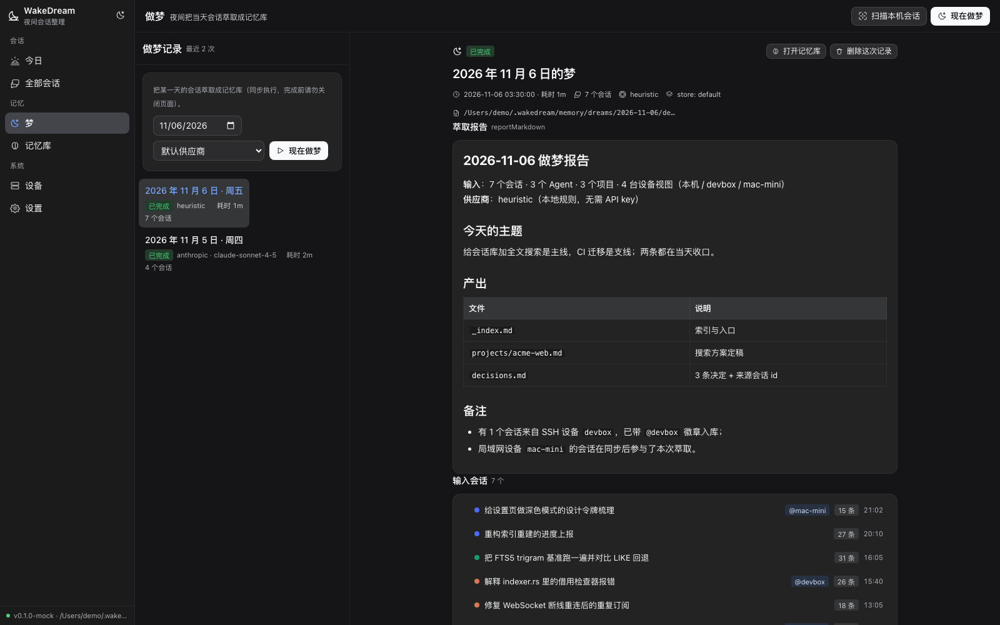
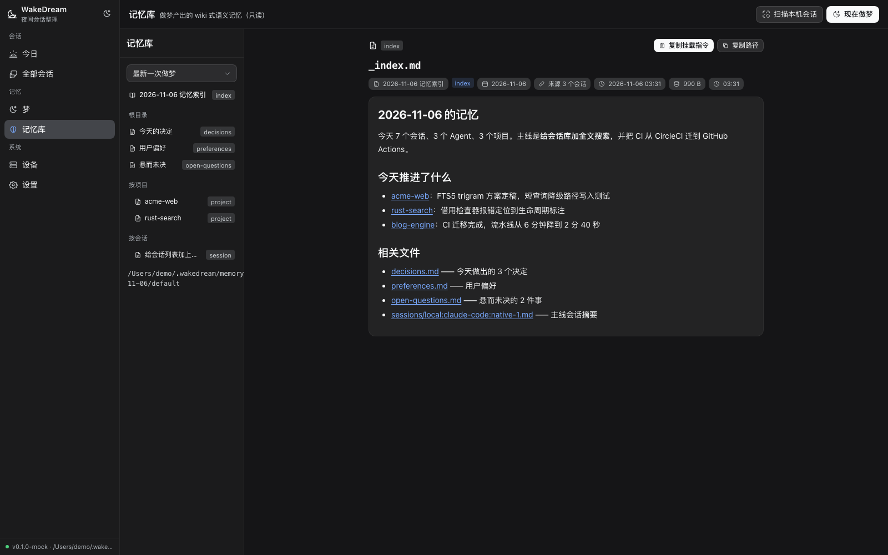
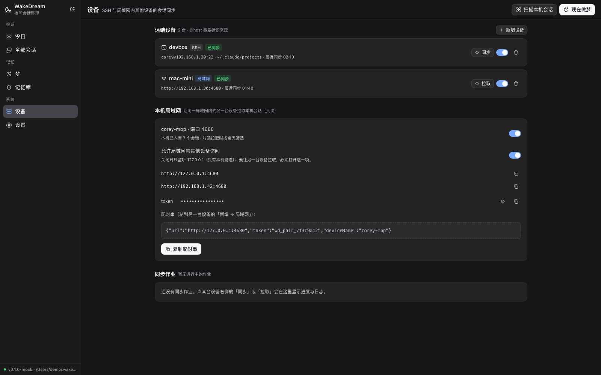
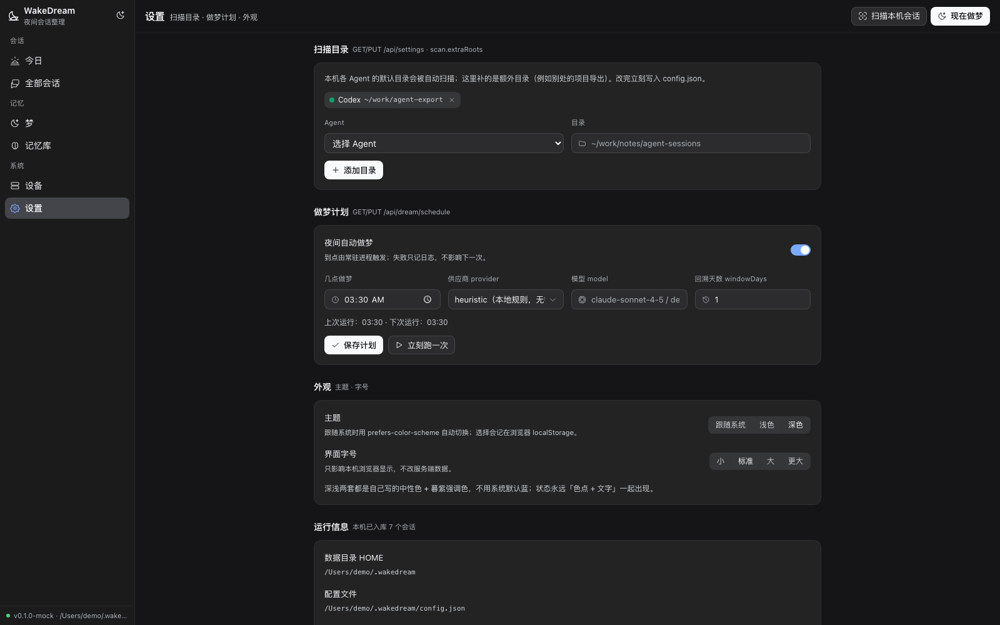

# WakeDream

**夜间会话整理客户端**：白天你与本机、以及 SSH/局域网可达的其他设备上的多个 Agent（DeepSeek Harness、Claude Code、Codex、Cursor …）各自作业；夜里 WakeDream 把**当天所有设备上的会话**收拢到一处，跑一次**「做梦（dreaming）」**，把会话萃取成一套 **wiki 式语义记忆库**，供以后的会话只读挂载。

一句话：**收**（提取会话，含 SSH/局域网同步）→ **梦**（夜间萃取记忆）→ **用**（浏览、检索、把记忆挂给下一个会话）。



## 它解决什么问题

Agent 每次开会话都从零开始：昨天讨论到哪、定了什么、哪里还没定，它不知道；这些上下文散在 `~/.claude`、`~/.codex`、`~/.dsh` 等各自的私有目录里，跨设备更散。WakeDream 把「当天所有 Agent 会话」在夜间批量整理成一份可以被人和 Agent 直接读的记忆，并保留回到原始会话的链接。

## 快速开始

要求 **Node.js ≥ 22.5**（内置 `node:sqlite`），零第三方运行时依赖，**不需要 `npm install`**。

```bash
node bin/scan.js          # 1) 扫描本机各 Agent 的会话，建索引
node bin/dream.js         # 2) 夜间做梦：先扫描，再把「当天」会话萃取成记忆库
node src/server/main.js   # 3) 启动客户端 → http://127.0.0.1:4680
```

数据全部在本机 `~/.wakedream`（`WAKEDREAM_HOME` 可改）：`db.sqlite`（索引）、`cache/remote/`（远端镜像）、`memory/dreams/<日期>/<store>/`（记忆库）。

装成每晚自动跑（macOS）：

```bash
scripts/install-nightly.sh 03:30     # launchd 定时；scripts/uninstall-nightly.sh 卸载
# Linux 直接写 crontab：30 3 * * * cd <repo> && node bin/dream.js >> ~/.wakedream/logs/dream.log 2>&1
```

## 桌面客户端（Tauri）

仓库同时是一个 **Tauri v2** 桌面应用（不是 Electron）：Tauri 壳在启动时拉起随包分发的 Node 边车（官方 SEA 打成单文件二进制），等 `/api/health` 就绪后打开窗口，退出时回收边车。

```bash
cd desktop && npm install        # 只装构建期依赖（@tauri-apps/cli / esbuild / postject），运行期零依赖

# 开发态：没有边车二进制时自动退回系统 node 跑 src/server/main.js
./desktop/node_modules/.bin/tauri dev

# 出安装包：先打边车（Node SEA 单文件），再打包
node scripts/build-sidecar.mjs --target aarch64-apple-darwin
./desktop/node_modules/.bin/tauri build          # macOS 出 .app/.dmg
```

三平台各自的依赖、产物位置、以及我们**只在 macOS arm64 真机构建与启动验证过**这件事，写在 [`docs/DESKTOP.md`](docs/DESKTOP.md)；`.github/workflows/desktop.yml` 是三平台的自动打包工作流。

## 三个动作

### 收：把会话收进来

| 来源 | 说明 |
|---|---|
| 本机 | `~/.dsh/sessions/**`（DeepSeek Harness，含多帧 `.zstd`）、`~/.claude/projects/**`、`~/.codex/sessions/**`、`~/.cursor/projects/**` 等，**只读**扫描、增量索引（mtime+size 双比较）、可随时重建 |
| SSH 远端 | 用 `ssh` + `rsync`（缺失时降级 `ssh … tar`）把远端**白名单目录**里的会话镜像到本地缓存再解析入库；远端只读、不拉凭证；会话带 `@host` 徽章 |
| 局域网 | 同一 Wi-Fi 的另一台设备跑着 WakeDream 时，用「地址 + 配对 token」直接拉取它当天的会话；对端只暴露会话元数据与正文，token 校验，`wakedream://pair?…` 配对串一键复制 |

### 梦：夜间萃取

产出 `~/.wakedream/memory/dreams/<YYYY-MM-DD>/<store>/`：

```
_index.md                 总览 + 索引 + 当天会话清单
projects/<项目>.md        这个项目今天推进了什么、结论、未决
decisions.md              当天做出的决定（带理由与来源会话 id）
preferences.md            你的偏好/工作方式（跨天累积，重复出现才升级）
open-questions.md         悬而未决、需要跟进的事
people.md                 出现的人/协作方
sessions/<会话id>.md      单会话摘要
report.md / manifest.json  给人看的报告 / 机器可读的文件 → 来源映射
```

- **每条结论都带 `source_sessions`**，可顺着相对链接回到原始会话；记忆库是**只读挂载**给未来会话的（`_index.md` 末尾给出可复制的挂载指令）。
- provider 三选一：`heuristic`（默认，**全程本地、零网络**）、`anthropic`、`openai-compatible`（自配 baseURL/apiKey/model，兼容 DeepSeek、OpenAI 风格端点）。用模型时成本写进 `dreams.stats` 与报告。
- 幂等（同一天重跑覆盖同一目录、先写临时目录再原子 rename）、`--dry-run` 不落盘、`force=false` 且没有新会话时 `skipped`；**永不写别家 agent 目录、永不改原始会话**。

### 用：客户端

六个页面：**今日**（当天时间线 + 统计 + 一键做梦）、**会话**（按 Agent/项目分组、筛选、搜索 + 转录阅读：气泡、工具调用折叠、thinking、代码高亮）、**梦**（历次报告与输入会话）、**记忆**（文件树 + 渲染 + 复制挂载指令）、**设备**（SSH/局域网同步与配对）、**设置**。

| 会话 | 转录阅读 |
|---|---|
|  |  |

| 做梦报告 | 记忆库 |
|---|---|
|  |  |

| 设备与同步 | 设置 |
|---|---|
|  |  |

> 上面这些截图全部来自**合成数据**（`web/dev-mock-server.mjs`），不含任何真实会话内容。

## 项目结构

```
bin/                 命令行入口（scan / dream / sync）
src/server/          HTTP 服务与数据层
  sessions/          各 Agent 适配器、扫描器、查询
  sync/              SSH 镜像与局域网对端
  dream/             做梦引擎（collect → analyze → organize → index）、provider、记忆库读写、调度
  api/               路由（契约见 docs/ARCHITECTURE.md）
src/shared/          路径与配置
web/                 手写 ESM + CSS 的前端（无打包器、无 CDN）
src-tauri/           Tauri v2 桌面壳（Rust）
desktop/             边车打包脚手架
scripts/             边车构建、夜间定时安装
test/                node --test 用例（含端到端 e2e）
docs/                架构契约、产品定义、桌面构建说明
```

## 开发与测试

```bash
node --test "test/**/*.test.js"     # 全量（含 e2e：真实起服务 + 扫真实本机会话）
node --test test/dream.test.js      # 单模块
node web/dev-mock-server.mjs --port 4780   # 纯假数据跑前端，不需要真实会话
```

界面视觉基线、接口契约与记忆库文件形状见 [`docs/ARCHITECTURE.md`](docs/ARCHITECTURE.md) 与 [`docs/PRODUCT.md`](docs/PRODUCT.md)。

## 已知边界

- 目前有真实解析器的是 8 个 Agent：DeepSeek Harness、Claude Code、Codex、Cursor、Gemini CLI、Kimi Code、Qoder CLI、Kiro；其余只在界面里列出。Windsurf/Trae（加密）、Amp/Factory/Warp（云端）无法支持。
- 摘要层需要模型，默认 `heuristic` 不联网；用模型时会把当天会话正文发给你自己配置的端点，是否开启由你决定。
- 文档监听是「手动/定时扫描」，没有 fs.watch 实时刷新；搜索是子串匹配（未上 FTS5）；局域网配对用配对串而非二维码。

## 许可证

[MIT](LICENSE)。

## 致谢

- **[Wake](https://github.com/iAmCorey/Wake)** —— 多 Agent 会话管理器的信息架构与视觉约定（分组列表、`@host` 远程徽章、Remote hosts 的 SSH 白名单镜像思路）都从这里学来；`test/fixtures/` 下部分合成测试数据也由其测试样本改写（MIT）。本项目是独立实现，仓库内**不含** Wake 的源码。
- **[Claude Cookbook：Dreaming with a dynamic workflow](https://platform.claude.com/cookbook/managed-agents-cma-dreaming-with-a-dynamic-workflow)**（作者 Brad Abrams）—— 「夜间做梦」这套机制（导出会话 → 逐个分析 → 收敛成 wiki 式记忆库 → 只读挂载）的思路来源。
- **DeepSeek Harness** —— 这个项目从第一行代码到验证、打包、发布，都是用它开发的。

[](https://github.com/deepseek-ai/deepseek-harness)
